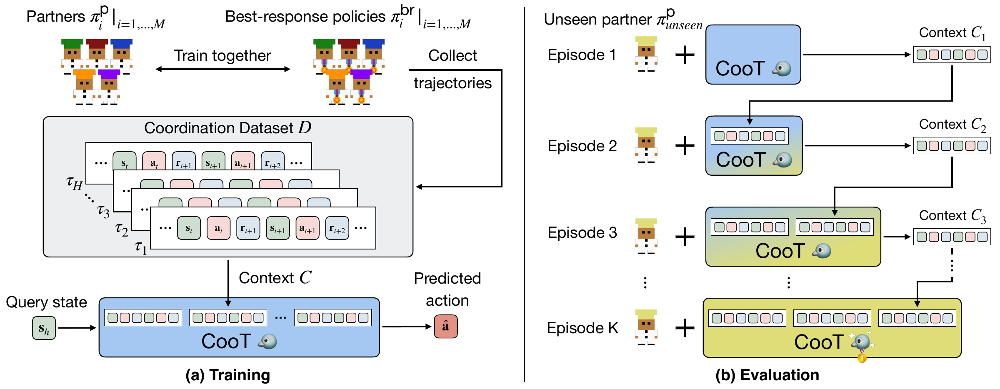

# CooT: Learning to Coordinate In-Context with Coordination Transformers

Code for **Coordination Transformer (CooT)** (ICML 2026), an in-context learning framework that adapts to unseen partners by conditioning on recent interaction histories, without parameter updates.

[Project page](https://coot-project.github.io/coot/)

This repository covers CooT on Overcooked: generating partner/best-response rollouts, building the CooT dataset, training CooT, and evaluating it with unseen partners. Baselines and the Google Research Football experiments are not included.

<p align="center">
  
</p>

## Contents

- [Installation](#installation)
- [Partner pool](#partner-pool)
- [Pipeline](#pipeline)
- [Reproducing the paper](#reproducing-the-paper)
- [Smoke test](#smoke-test)
- [Repository layout](#repository-layout)
- [Acknowledgements](#acknowledgements)
- [Citation](#citation)

## Installation

Requires Linux with an NVIDIA GPU, Python 3.9 and PyTorch 1.13 (CUDA 11.7 wheels). The release was checked on an RTX 4090.

```bash
bash setup_env.sh coot      # creates the conda env "coot"
conda activate coot
```

`setup_env.sh` runs:

```bash
conda create -n coot python=3.9.15
pip install torch==1.13.0+cu117 torchvision==0.14.0+cu117 --extra-index-url https://download.pytorch.org/whl/cu117
pip install -r requirements.txt
pip install -e zsceval
```

Logging to Weights & Biases is off by default; add `--wandb` to `train.py` / `eval_mean_var.py` to enable it.

## Partner pool

CooT is trained on rollouts of biased partners paired with their best responses (BRs), and evaluated against held-out biased partners. These pretrained partners come from two places:

| Partners | Layouts | Source |
|---|---|---|
| HSP biased agents + BRs | `random1` | `random1_hsp_partners.tar.gz` from this repository's [Releases](../../releases) |
| HSP biased agents + BRs | `random1_m`, `random3`, `unident_s`, `random0_medium` | [ZSC-Eval policy pool](https://huggingface.co/Leoxxxxh/ZSC-Eval-policy_pool) |
| MEP agents | all layouts | [ZSC-Eval policy pool](https://huggingface.co/Leoxxxxh/ZSC-Eval-policy_pool) |

The `random1` HSP partners were trained by us with ZSC-Eval's HSP stage 1 (`zsceval/zsceval/scripts/overcooked/shell/train_bias_agents.sh`); they differ from the `random1` models in the ZSC-Eval pool, so use the released ones to match the partner seeds in `configs/layouts/random1.yaml`.

Download both and assemble them into the layout the scripts expect (`policy_pool/<layout>/{hsp,mep}/`):

```bash
# ZSC-Eval pool (needs git-lfs)
git lfs install
git clone https://huggingface.co/Leoxxxxh/ZSC-Eval-policy_pool zsc_eval_pool

# random1 HSP partners from the Releases page
mkdir -p downloads
tar -xzf random1_hsp_partners.tar.gz -C downloads

python tools/prepare_partner_pool.py --out policy_pool \
    --hsp_src "zsc_eval_pool/{layout}/hsp/s1/hsp" \
    --hsp_src_override "random1=downloads/random1/hsp" \
    --mep_src "zsc_eval_pool/{layout}/mep/s1/mep-S1-s15"
```

`prepare_partner_pool.py` symlinks the files (add `--copy` to copy them) and lists any partner it cannot find. Which partners are used for training, validation and evaluation is fixed per layout in `configs/layouts/<layout>.yaml` (21 HSP + 15 MEP training partners; 10 evaluation partners, 15 for `random1_m`).

Layout names used in the code:

| Paper | Code |
|---|---|
| Coord. Ring | `random1` |
| Coord. Ring Multi-recipe | `random1_m` |
| Counter Circ. | `random3` |
| Asymm. Adv. | `unident_s` |
| Bothway Coord. | `random0_medium` |

## Pipeline

All paths default to folders inside the repository and can be changed with flags (`--rollout_dir`, `--dataset_dir`, `--model_dir`, `--results_dir`, `--partner_pool_dir`) or environment variables (`COOT_ROLLOUT_DIR`, ...); see `coot_config.py`. The commands below use `random1` and training seed 0.

**1. Render partner / best-response rollouts** (`rollouts/<layout>/raw/`)

```bash
python render_rollouts.py --layout_name random1
```

Per training partner this renders 160 episodes at final skill, 30 with small action noise (0.15), 30 with mid noise (0.25) and 30 at mid skill for HSP partners, 200 episodes for MEP partners, and 50 episodes per validation partner (`configs/data_recipe.yaml`).

**2. Compose the rollout pools** (`rollouts/<layout>/{hsp_train,mep_train,hsp_val}/`)

```bash
python compose_rollouts.py --layout_name random1
```

**3. Build the CooT dataset** (`datasets/<prefix>/`; about 5–20 GB per layout)

```bash
python collect_data.py --env overcooked --layout_name random1 \
    --hists 125 --samples 70 --episode_length 200 --ctx_rollouts 5 --num_query 6 \
    --dataset_prefix rand1_ctx5
```

M = 36 partners × K = 125 contexts × L = 70 queries, T = 5 episodes per context.

**4. Train CooT** (`models/<layout>/<model_subdir>/`)

```bash
python train.py --env overcooked --layout_name random1 --agents 36 --hists 125 --samples 70 \
    --H 200 --lr 0.00005 --layer 4 --head 2 --dropout 0.3 --embd 128 --wd 0.001 \
    --num_epochs 70 --patience 25 --grad_clip 0.25 --batch_size 120 --label_smoothing 0.0 \
    --use_step_masking --mask_steps_per_episode 70 --use_curriculum_masking --mask_schedule logarithmic \
    --num_query 6 --ctx_rollouts 5 --transformer gpt2 --shuffle --rollin_type expert \
    --dataset_prefix rand1_ctx5 --model_subdir rand1_ctx5_s0 --seed 0
```

**5. Evaluate with unseen partners** (`eval_csv/<layout>/`)

```bash
python eval_mean_var.py --env overcooked --layout_name random1 --agents 36 --hists 125 --samples 70 \
    --H 200 --lr 0.00005 --layer 4 --head 2 --dropout 0.3 --embd 128 --wd 0.001 --batch_size 120 \
    --use_step_masking --mask_steps_per_episode 70 --label_smoothing 0.0 --use_curriculum_masking \
    --mask_schedule logarithmic --num_query 6 --ctx_rollouts 5 --transformer gpt2 --shuffle \
    --model_subdir rand1_ctx5_s0 --seed 0 --epoch 20 --n_eval 1 --hor 200 \
    --seed_type test --heps 50
```

The model hyperparameters must match training, since they determine the checkpoint name (or pass `--ckpt_path`). CooT starts with an empty context and plays `--heps` consecutive episodes with each evaluation partner, appending every episode to its context. The csv has one row per 5-episode window (adaptation curves, Fig. 2 / 7) and one `0-49` row per partner with the mean return and BR-prox.

## Reproducing the paper

Run steps 1–5 for each layout and training seed (0, 1, 2) and average the per-seed `0-49` means. Pretrained CooT checkpoints are not released; results vary with the training seed (see the standard deviations in the paper).

| Experiment | What to change |
|---|---|
| Table 1, Fig. 2 / 7 | steps 1–5 for the five layouts, seeds 0–2 |
| Table 4 (partner switching) | `python eval_overcooked_switch.py <model args> --layout_name random1 --partner_a A --partner_b B --heps 25 --switch_episodes 15 --both_directions` with pairs (15, 31), (15, 17), (17, 31); 15 = Active, 31 = Still, 17 = Dish-averse |
| Table 14 (evaluation partner sets) | step 5 with `--seed_type set2` / `set3` (`random1`) |
| Table 15 (context length) | `--ctx_rollouts 1 / 3 / 5 / 7` in steps 3, 4 and 5 |
| Table 16 (context shuffling) | step 4 with `--shuffle` (chunk-wise, 20 steps, default), `--shuffle --shuffle_chunk_size 1` (step-wise), or without `--shuffle` |
| Table 18 (number of partners) | step 3 with `--population 24` / `12`, step 4 with `--agents 24` / `12` (`random1`) |
| Table 19 (trajectories per partner) | step 2 with `--scale 0.8` (200) / `0.6` (150) |

`eval_overcooked_switch.py` prints the number of episodes after the switch until CooT reaches `--target_reward` (default 60) and saves per-episode returns to `eval_csv/switch/`.

## Smoke test

Checks that every stage runs, on all five layouts, with tiny settings (2 partners per split, 9 episodes per rollout group, 1 training epoch). Needs the partner pool; takes about 10 minutes on one RTX 4090.

```bash
bash smoke_test.sh
```

## Repository layout

```
configs/layouts/<layout>.yaml   partner seeds, state shape, reward weights per layout
configs/data_recipe.yaml        rollouts rendered per partner
coot_config.py                  config loader and path defaults
render_rollouts.py              step 1 (calls zsceval/zsceval/scripts/render/render_overcooked.py)
compose_rollouts.py             step 2
collect_data.py                 step 3
train.py, dataset.py, net.py    step 4 (CooT model: GPT-2 backbone)
eval_mean_var.py                step 5
eval_overcooked_switch.py       partner switching (Table 4)
tools/prepare_partner_pool.py   assemble the partner pool
zsceval/                        Overcooked environments, MAPPO, HSP/MEP training (from ZSC-Eval)
```

## Acknowledgements

`zsceval/` is adapted from [ZSC-Eval](https://github.com/sjtu-marl/ZSC-Eval) (MIT License, see `zsceval/LICENSE`), which builds on [HSP](https://github.com/samjia2000/HSP) and [overcooked_ai](https://github.com/HumanCompatibleAI/overcooked_ai). The CooT model follows [Decision-Pretrained Transformer](https://arxiv.org/abs/2306.14892).

## Citation

```bibtex
@inproceedings{wang2026coot,
  title     = {CooT: Learning to Coordinate In-Context with Coordination Transformers},
  author    = {Wang, Huai-Chih and Chuang, Hsiang-Chun and Cheng, Hsi-Chun and Wu, Dai-Jie and Sun, Shao-Hua},
  booktitle = {International Conference on Machine Learning (ICML)},
  year      = {2026}
}
```
